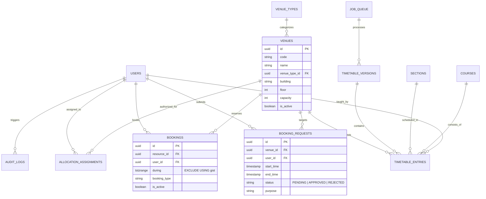

# Campus Free Slot Finder — Full-Stack Academic Space Management & Timetable Intelligence

[](https://www.python.org/)
[](https://fastapi.tiangolo.com/)
[](https://www.postgresql.org/)
[](https://react.dev/)
[](https://www.typescriptlang.org/)
[](https://vitejs.dev/)
[](https://www.docker.com/)

A full-stack web application designed for college campuses (specifically modeled for Graphic Era Hill University) that solves campus room discovery, teacher location tracking, and venue reservations while rigorously demonstrating and implementing **core Database Management Systems (DBMS)** and **Operating Systems (OS)** principles in production-grade code.

---

## Table of Contents
1. [Core Features & Functional Modules](#1-core-features--functional-modules)
2. [Operating Systems & DBMS Architecture](#2-operating-systems--dbms-architecture)
   - [DBMS Concepts Implemented](#a-dbms-concepts-implemented)
   - [Operating Systems Concepts Implemented](#b-operating-systems-concepts-implemented)
3. [Database Entity-Relationship Schema](#3-database-entity-relationship-schema)
4. [Project Structure](#4-project-structure)
5. [Quickstart: Local Development](#5-quickstart-local-development)
6. [Quickstart: Docker Compose](#6-quickstart-docker-compose)
7. [Demo Accounts & Personas](#7-demo-accounts--personas)
8. [Automated Test Suite](#8-automated-test-suite)
9. [Evaluation & Demonstration Guide](#9-evaluation--demonstration-guide)

---

## 1. Core Features & Functional Modules

### Module A: Intelligent Free Slot Finder
- **Real-Time Free Slot Calculation**: Uses half-open mathematical intervals $[start, end)$ to find unoccupied classrooms, lecture theatres, computer labs, seminar halls, and auditoriums.
- **4-State Space Integrity**:
  - `AVAILABLE`: Fully verified free from published timetable clashes and confirmed bookings.
  - `OCCUPIED`: Clashes with scheduled lectures, lab practicals, or approved student club activities.
  - `RESTRICTED`: Venue requires specialized deanery permissions or is temporarily reserved.
  - `UNKNOWN`: Strict safety fallback if the space or time window lacks verified timetable coverage (never falsely assumed free).
- **Multi-Factor Filtering**: Filter by Date, Time Presets (Period 1–8, 60-min blocks), Building, Space Type, Capacity, and Amenities (Projector, AC, PA audio).

### Module B: Teacher Schedule & Venue Finder
- **Teacher Daily Timetable**: Search any faculty member (e.g. *Dr. Rajesh Verma*, *Dr. Ananya Sharma*) to see their day-by-day timetable across all academic sections.
- **Live "Next Class" Tracker**: Displays current room and upcoming lecture locations based on campus time.
- **Consultation Hours Finder**: Automatically derives open periods when faculty members are free from lecture obligations for student mentorship or project reviews.

### Module C: Venue Booking & Approval Workflow
- **Student Club & Event Requests**: Submit requests with purpose, estimated attendance, required A/V equipment, and faculty sponsor.
- **Scoped Allocation Faculty Inbox**: Requests automatically route **only** to faculty members authorized for that specific room or building.
- **Anti Self-Approval Constraint**: Backend strictly prevents faculty from approving their own booking submissions.
- **Idempotency Guarantee**: Requests support `Idempotency-Key` headers to prevent duplicate submissions over flaky network connections.

### Module D: Timetable Ingestion Engine
- **Vector PDF Coordinate Parsing**: Uses `pdfplumber` to extract table column and row bounding boxes directly from institutional PDF timetables (handling merged 2-period lab practicals like *PCS 502* across multiple slots).
- **Two-Phase Commit / Safe Staging**: Uploaded timetables remain in `DRAFT` status. Administrators can preview detected clashes against existing bookings before activating them as `PUBLISHED`.

### Module E: OS & DBMS Concept Verification Lab
- An interactive evaluation suite directly in the frontend UI to demonstrate academic concepts to hackathon judges and evaluators:
  - **Live Concurrency Race**: Fires 20 to 50 concurrent threads simultaneously targeting the exact same room and slot against PostgreSQL 18.
  - **FCFS Scheduling Engine**: Interactive Gantt chart with Arrival Time, Burst Time, Turnaround Time (TAT), and Waiting Time (WT) analysis.
  - **Deadlock Coffman Conditions**: Visual demonstration of circular wait vs strict resource hierarchy ordering.
  - **Critical Section & Mutex**: Sliders for threads and increments showing lost updates (race condition) vs atomic Mutex protection.

---

## 2. Operating Systems & DBMS Architecture

### A. DBMS Concepts Implemented

| Concept | Location in Codebase | Technical Implementation |
| :--- | :--- | :--- |
| **Storage Engine Exclusion Constraints** | `backend/alembic/versions/957fdbdfe1e9_initial_schema.py` | PostgreSQL 18 `btree_gist` index enforcing `EXCLUDE USING gist (campus_id WITH =, resource_id WITH =, during WITH &&) WHERE (is_active = true)`. Guarantees zero double-bookings at the physical storage layer. |
| **Row-Level Locking (`FOR UPDATE`)** | `backend/app/services/booking_service.py` | `db.query(BookingRequest).filter(...).with_for_update().first()` locks the request row against concurrent approvals. |
| **PostgreSQL Advisory Locks** | `backend/app/services/booking_service.py` | Transaction-level advisory lock `pg_advisory_xact_lock(hashtext(lock_key))` serializes conflicting approval workflows for the same physical space. |
| **Half-Open Intervals $[start, end)$** | `backend/app/services/availability_engine.py` | Avoids fencepost errors when a class ends at 10:10 and the next starts at 10:10. |
| **ACID Atomic Approval** | `backend/app/services/booking_service.py` | Single transaction: (1) Locks request, (2) Checks scopes, (3) Inserts into `bookings`, (4) Updates request state to `APPROVED`, (5) Logs immutable audit trail. Any constraint violation rolls back the entire state cleanly. |
| **Idempotency Key Cache** | `backend/app/services/booking_service.py` | Caches SHA-256 idempotency tokens; identical retries return the original committed response without duplicating side effects. |

### B. Operating Systems Concepts Implemented

| Concept | Location in Codebase | Technical Implementation |
| :--- | :--- | :--- |
| **OS Process Separation** | `backend/worker/worker.py` & `backend/app/main.py` | The HTTP web server (FastAPI) and the background worker daemon run as separate OS processes with independent memory spaces and PIDs. |
| **Durable Producer-Consumer Queue** | `backend/worker/job_runner.py` | Uses relational `job_queue` table with atomic `SELECT ... FOR UPDATE SKIP LOCKED` to allow worker processes to consume jobs without race conditions or starvation. |
| **Lease Expiration & Crash Recovery** | `backend/worker/job_runner.py` | If a worker process crashes mid-job, the lease expires (`locked_until < now()`). The recovery loop reclaims orphan jobs and resets them to `PENDING`. |
| **Multithreading Synchronization (Mutex)** | `backend/app/services/os_demo_service.py` | Compares unsynchronized thread increments (causing lost updates due to non-atomic read-modify-write CPU cycles) against `threading.Lock()` mutex synchronization. |
| **FCFS Process Scheduling** | `backend/app/services/os_demo_service.py` | Implementation of First-Come, First-Served non-preemptive queue scheduling algorithm calculating Start, Completion, Turnaround Time ($TAT = CT - AT$), and Waiting Time ($WT = TAT - BT$). |
| **Deadlock Prevention via Lock Ordering** | `backend/app/services/os_demo_service.py` | Evaluates the 4 Coffman conditions. Demonstrates how establishing a strict total resource ordering ($R_A < R_B$) mathematically eliminates the circular wait condition. |

---

## 3. Database Entity-Relationship Schema



---

## 4. Project Structure

```
PBL OS DBMS/
├── backend/
│   ├── alembic/                      # Database migrations (PostgreSQL schema)
│   │   └── versions/
│   │       └── 957fdbdfe1e9_initial_schema.py  # 18 relational tables & btree_gist
│   ├── app/
│   │   ├── api/                      # FastAPI Routers
│   │   │   ├── admin.py              # Venue master & audit log endpoints
│   │   │   ├── allocation.py         # Allocation faculty inbox & approvals
│   │   │   ├── auth.py               # Argon2id auth & demo role switcher
│   │   │   ├── availability.py       # Half-open slot availability engine
│   │   │   ├── os_demonstrations.py  # Concurrency, FCFS, Deadlock, Mutex APIs
│   │   │   ├── requests.py           # Student booking submission & withdrawal
│   │   │   ├── teachers.py           # Teacher schedule & free periods
│   │   │   └── timetable.py          # PDF upload & version publishing
│   │   ├── core/                     # Configuration, database engine & security
│   │   │   ├── cache.py              # Valkey cache with direct DB fallback
│   │   │   ├── config.py             # Pydantic v2 settings
│   │   │   ├── database.py           # SQLAlchemy 2.0 session factory
│   │   │   └── security.py           # Password hashing & session cookies
│   │   ├── models/                   # SQLAlchemy declarative models (18 tables)
│   │   ├── schemas/                  # Pydantic request/response validation
│   │   ├── services/                 # Core business & algorithmic logic
│   │   │   ├── availability_engine.py
│   │   │   ├── booking_service.py
│   │   │   ├── os_demo_service.py
│   │   │   └── timetable_parser.py
│   │   └── main.py                   # FastAPI application root
│   ├── tests/                        # 11 Automated Pytest Integration Tests
│   ├── worker/                       # Independent OS Worker Daemon Process
│   │   ├── job_runner.py             # Durable queue producer-consumer logic
│   │   └── worker.py                 # Worker process entrypoint
│   ├── requirements.txt
│   └── seed_data.py                  # Initial demo data & timetable seeder
├── frontend/
│   ├── src/
│   │   ├── pages/
│   │   │   ├── AdminManagement.tsx   # Venue register, scopes & audit logs
│   │   │   ├── AllocationInbox.tsx   # Scoped approval dashboard
│   │   │   ├── FreeSlotFinder.tsx    # Availability grid & slot timeline
│   │   │   ├── HomePage.tsx          # System KPIs & overview
│   │   │   ├── OsDbmsLab.tsx         # Live concurrency race & OS simulator
│   │   │   ├── TeacherFinder.tsx     # Teacher timetable lookup
│   │   │   ├── TimetableAdmin.tsx    # PDF parser & conflict preview
│   │   │   └── VenueBooking.tsx      # Booking form & my requests
│   │   ├── services/
│   │   │   └── api.ts                # Typed frontend API client
│   │   ├── App.tsx                   # Main layout & demo role switcher
│   │   ├── index.css                 # Glassmorphism dark design system
│   │   └── main.tsx
│   ├── package.json
│   ├── tsconfig.json
│   └── vite.config.ts
├── deploy/
│   ├── Caddyfile                     # Reverse proxy configuration
│   ├── docker-compose.yml            # Multi-container orchestration
│   ├── Dockerfile.backend            # Python 3.12 backend container
│   ├── Dockerfile.frontend           # Multi-stage Node/Caddy container
│   └── init-extensions.sql           # btree_gist init script
└── README.md
```

---

## 5. Quickstart: Local Development

### Prerequisites
- Python 3.12+ (tested up to 3.14)
- Node.js 18+ and npm
- PostgreSQL 18 with `btree_gist` extension

### 1. Database Setup
Ensure PostgreSQL is running and create the database:
```sql
CREATE DATABASE postgres;
\c postgres
CREATE EXTENSION IF NOT EXISTS "uuid-ossp";
CREATE EXTENSION IF NOT EXISTS "btree_gist";
```

### 2. Backend Setup
```bash
cd backend

# Create and activate virtual environment
python -m venv .venv
# Windows:
.venv\Scripts\activate
# Linux/macOS:
source .venv/bin/activate

# Install dependencies
pip install -r requirements.txt

# Run migrations
alembic upgrade head

# Seed initial timetable, venues, and users
python seed_data.py

# Start FastAPI server
python -m uvicorn app.main:app --host 127.0.0.1 --port 8000 --reload
```

### 3. Background Worker Process (OS Separation)
In a separate terminal:
```bash
cd backend
.venv\Scripts\activate
python -m worker.worker
```

### 4. Frontend Setup
```bash
cd frontend

# Install dependencies
npm install

# Start Vite dev server
npm run dev
```
Open **`http://localhost:5173`** in your browser.

---

## 6. Quickstart: Docker Compose

To spin up the entire cluster (PostgreSQL 18, Valkey, FastAPI Backend, Background Worker, and Caddy Reverse Proxy) with a single command:

```bash
cd deploy
docker compose up --build
```
Access the application at **`http://localhost`**.

---

## 7. Demo Accounts & Personas

The application includes an instant **Demo Role Switcher** dropdown in the top-right header, allowing evaluators to switch roles on the fly:

| Persona | Name | Email | Role | Responsibilities |
| :--- | :--- | :--- | :--- | :--- |
| **Student** | Rohan Sharma | `student@gehu.ac.in` | `STUDENT` | Search free rooms, lookup teachers, submit club requests |
| **Faculty** | Dr. Rajesh Verma | `dr.verma@gehu.ac.in` | `FACULTY` | View own lecture schedule, request seminar venues |
| **Allocation Faculty** | Prof. K.P. Nautiyal | `prof.nautiyal@gehu.ac.in` | `ALLOCATION_FACULTY` | Scoped authority to approve/reject bookings for Auditorium & CS Block |
| **Administrator** | Dr. Dean Academic | `admin@gehu.ac.in` | `ADMIN` | Ingest timetable PDFs, manage venues, full system governance |

*Default password for all accounts in local seed:* `password123`

---

## 8. Automated Test Suite

The project includes an end-to-end integration test suite verifying concurrency, exclusion constraints, and OS concepts:

```bash
cd backend
pytest -v
```

### Test Coverage Highlights:
- `test_exclusion.py`: Confirms PostgreSQL 18's `btree_gist` constraint rejects overlapping intervals with `IntegrityError` (`exclusion_violation 23P01`).
- `test_availability.py`: Verifies half-open interval math and confirms unverified coverage returns `UNKNOWN`.
- `test_booking.py`: Verifies scoped inbox routing, no-self-approval enforcement, and withdrawal flows.
- `test_concurrency.py`: Launches 20 concurrent threads against the PostgreSQL database; asserts that **exactly 1** booking succeeds while **19** are rejected.
- `test_os_concepts.py`: Validates FCFS average turnaround/waiting time calculations, deadlock circular wait vs resource ordering, and worker queue lease recovery.

---

## 9. Evaluation & Demonstration Guide

When demonstrating this project to university evaluators or hackathon judges, follow this step-by-step walkthrough:

1. **Demonstrate DBMS Exclusion Constraints (OS & DBMS Lab)**:
   - Go to the **OS & DBMS Lab** tab.
   - Click **"Launch 20 Threads"**.
   - Show the evaluator the live kernel log: 20 threads simultaneously hit the same slot. Exactly 1 transaction commits (200 OK); 19 are rolled back by PostgreSQL's `23P01` exclusion constraint.
2. **Demonstrate First-Come, First-Served (FCFS) Scheduling**:
   - In the Lab, click **FCFS Process Scheduling**.
   - Modify the arrival or burst times of requests and click **"Calculate FCFS Schedule"**.
   - Show the dynamic Gantt chart and calculated Waiting Time (WT) and Turnaround Time (TAT).
3. **Demonstrate Deadlock Prevention via Resource Hierarchy**:
   - In the Lab, switch to **Deadlock & Resource Hierarchy**.
   - Run in "Deadlock" mode to show circular wait ($T_1 \to R_A \to R_B \land T_2 \to R_B \to R_A$).
   - Switch to "Apply Lock Ordering" to demonstrate how strict ordering breaks the circular wait condition.
4. **Demonstrate Teacher Venue Lookup**:
   - Go to **Teacher Lookup** and type `Verma`.
   - Point out how the timetable data reflects merged multi-period labs (*PCS 502* 14:10–16:00).
5. **Demonstrate Scoped Approval & Anti-Self-Approval (RBAC)**:
   - Use the Role Switcher to switch to **Student** and submit a booking request for `KP Nautiyal Auditorium`.
   - Switch to **Allocation Faculty** (`prof.nautiyal@gehu.ac.in`). Open **Allocation Inbox** to approve it with an ACID transaction.
   - Try to approve a request created by oneself to demonstrate the anti-self-approval rule enforcement.

---

*Developed for the Project Based Learning (PBL) Curriculum in Operating Systems & Database Management Systems.*
